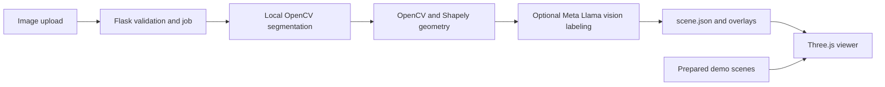

# FloorPlan3D

FloorPlan3D converts 2D floor-plan images into metric scene data and a navigable Three.js model. Prepared one-story and two-story demos run offline and need no API key.

## Architecture



Segmentation runs locally using classical image processing, not a hosted model. Optional room labels use Meta's Llama-compatible API. Without a key or when labeling fails, the app uses generic room names and records a warning. The map assistant remains a deterministic local scene lookup.

## Run on Windows

```powershell
py -3.12 -m venv .venv
.\.venv\Scripts\python.exe -m pip install -r requirements.txt
Copy-Item .env.example .env
.\.venv\Scripts\python.exe app.py
```

Open http://127.0.0.1:5000. If the Python launcher is unavailable, use your installed Python executable to create the environment. Use the same environment for install and run.

## Run on macOS or Linux

```sh
python3 -m venv .venv
.venv/bin/python -m pip install -r requirements.txt
cp .env.example .env
.venv/bin/python app.py
```

## What works without a key

Both prepared demos, upload processing, local heuristic segmentation, generic room labels, and offline map questions. Four local segmentation jobs process rooms, walls, doors, and windows in parallel. Door and window masks may be omitted when the heuristic cannot identify them reliably; wall geometry can fall back to room outlines. Failure to detect rooms is reported clearly.

## Optional Llama room labels

The Llama API is used only to classify and name detected room candidates. Segmentation is entirely local. When access is available:

1. Open .env in the project folder.
2. Set LLAMA_API_KEY to the key from the API dashboard.
3. Set LLAMA_VISION_MODEL to the exact vision model ID from the dashboard; this project does not assume a model name.
4. Keep LLAMA_API_BASE_URL at https://api.meta.ai/v1 unless Meta's dashboard for your account specifies another URL.
5. Restart Flask. The health endpoint indicates whether the key and model settings are present.

The OpenAI SDK client, `https://api.meta.ai/v1` base URL, Chat Completions route, and base64 image format follow [Meta's vision input guide](https://dev.meta.ai/docs/cookbook/vision-input) and [image understanding reference](https://dev.meta.ai/docs/image-understanding). Configured settings do not prove your account has access to the chosen model; test with your key when available. Failures fall back to generic labels. Credentials are not logged or returned to the browser.

## Limitations

Heuristic segmentation works best on clean, high-contrast plans with closed room boundaries. Text, furniture, shadows, low contrast and door gaps can affect results. Door and window detections may be empty or incomplete. Scale and area are estimates and should be checked against known dimensions. This prototype is for visualization only, not construction, compliance, evacuation or safety decisions.

## Tests

Run python -m pytest -q. Tests use local fixtures and mocked API clients; they do not make real network calls. Llama image input and response compatibility remain unverified until tested with an account key.

To check local segmentation and geometry against the bundled sample plan without an API key, run `python scripts/evaluate_local_segmentation.py`. It reports mask and final geometry counts and applies loose fixture guardrails for room, wall, door, and window detection. This is a regression check for that one sample, not an accuracy score or a guarantee for other floor plans.

## Demo review flow

Use the sidebar's **Quick judge walkthrough** to rehearse the key features. The **Area Summary** review checklist reports structural details such as usable room outlines, detected wall/opening regions, scale calibration status, floor connectors, labels, and pipeline warnings. **Review 2D detections** opens the overlay; **Edit a room outline** selects a room and starts the boundary editor. Review all detected geometry and verify scale against a known dimension before relying on measurements.
