# FloorPlan3D 🏢➡️🌐

An AI-powered 3D indoor map generator built for hackathons.

**FloorPlan3D** takes a standard 2D floor plan image, uses **Meta SAM 3.1** via the Responses API to segment architectural entities (rooms, walls, doors, windows), converts binary masks into metric polygons in meters using **OpenCV** and **Shapely**, classifies and labels room identities with **Meta Muse Spark**, and exports a structured `scene.json`. A **Three.js** web client renders the resulting scene as a navigable 3D digital twin.

---

## Architecture & Data Flow

```mermaid
flowchart LR
    A[User 2D Image] --> B[Flask Backend /api/process]
    B --> C[Meta SAM 3.1 Responses API]
    C -->|stream: 'room', 'wall', 'door', 'window'| D[meta-sam-parser]
    D -->|Binary Rasters| E[OpenCV & Shapely]
    E -->|Metric Polygons in Meters| F[Meta Muse Spark]
    F -->|Classified Labels & Types| G[scene.json Contract]
    G --> H[Three.js r128 3D Viewer]
```



1. **Meta SAM 3.1 Segmentation (`sam-3.1`)**:
   - Uses the OpenAI-compatible Responses API at `https://api.meta.ai/v1`.
   - Sends **one short noun phrase per query** (`"room"`, `"wall"`, `"door"`, `"window"`).
   - Zero matches is treated as a normal result (not an error).
   - Streams tokens and decodes `<|box...|><|mask...|>` payloads into binary rasters using Meta's official `meta-sam-parser` library.

2. **OpenCV & Shapely Metric Geometry Engine**:
   - Morphological filtering (closing & opening) removes noise and bridges micro-gaps.
   - `cv2.findContours(..., cv2.RETR_CCOMP)` extracts external room boundaries and interior holes.
   - Douglas-Peucker polygon approximation snaps zigzag pixel boundaries into crisp, orthogonal architectural walls.
   - Scales pixels to real-world meters (`metersPerPixel`, default `0.02 m/px`).
   - Computes door-to-room spatial adjacency to populate `"connects": ["r1", "c1"]`.

3. **Meta Muse Spark Classification (`muse-spark-1.3`)**:
   - Uses standard-tier multimodal Muse Spark with JSON structured outputs.
   - Reads printed floor plan room numbers and OCR labels (e.g. *"Room 101"*, *"Computer Lab"*, *"Restroom"*).
   - Restricts classifications to the contract's allowed room types:
     `room`, `classroom`, `lab`, `corridor`, `stairs`, `elevator`, `restroom`, `entrance`, `other`.

4. **Three.js r128 3D Viewer**:
   - Pinned CDN dependencies (no build step, pure browser-native).
   - Extrudes 3D walls (`THREE.ExtrudeGeometry`) with hole cutouts.
   - Maps 2D floor plan coordinates $(x, y)$ in meters to 3D world space centered at $(0, 0, 0)$ for smooth OrbitControls.
   - Dynamic real-time wall height slider & cutaway mode.
   - Floating 3D canvas text badges for room names, types, and confidence scores.
   - Interactive Raycasting: click any room to inspect floor area ($m^2$, $sq\ ft$), boundary vertices, and connected doors.

---

## Project Structure

```
floorplan3d/
├── .env.example              # Template for Meta Model API key
├── .env                      # Local environment configuration
├── requirements.txt          # Python dependencies
├── app.py                    # Flask server & REST API endpoints
├── sam_service.py            # Meta SAM 3.1 & Muse Spark API integration
├── geometry_processor.py     # OpenCV + Shapely contour & polygon metric pipeline
├── demo_data.py              # Precomputed architectural sample & scene.json
├── samples/
│   └── sample_floorplan.png  # Synthesized high-resolution demo plan
├── static/
│   ├── css/
│   │   └── custom.css        # Glassmorphism styling and UI tweaks
│   └── js/
│       ├── viewer.js         # Three.js 3D floor plan renderer
│       └── app.js            # Frontend application controller & upload handlers
└── templates/
    └── index.html            # Tailwind-styled single page application
```

---

## `scene.json` Contract (Meters)

The pipeline outputs `scene.json` adhering to the exact hackathon specification:
- Coordinate system: **METERS**, origin top-left of plan, $x$ right, $y$ down.

```json
{
  "meta": {
    "source": "floorplan.png",
    "imageSize": [800, 600],
    "metersPerPixel": 0.02,
    "wallHeight": 3.0,
    "wallThickness": 0.2
  },
  "rooms": [
    {
      "id": "r1",
      "type": "classroom",
      "label": "Classroom 101",
      "confidence": 0.96,
      "polygon": [[1.12, 1.12], [7.28, 1.12], [7.28, 5.88], [1.12, 5.88]]
    }
  ],
  "walls": [
    {
      "id": "w1",
      "polygon": [[1.0, 1.0], [15.0, 1.0], [15.0, 11.0], [1.0, 11.0]],
      "holes": [[[1.12, 1.12], [7.28, 1.12], [7.28, 5.88], [1.12, 5.88]]]
    }
  ],
  "doors": [
    {
      "id": "d1",
      "center": [4.0, 6.0],
      "width": 0.72,
      "connects": ["r1", "r3"]
    }
  ],
  "windows": [
    {
      "id": "win1",
      "center": [4.4, 1.0],
      "width": 1.6
    }
  ]
}
```

---

## Quickstart Guide

### 1. Install Dependencies
```bash
pip install -r requirements.txt
```

### 2. Configure Environment Variables
Copy `.env.example` to `.env`:
```bash
cp .env.example .env
```
Edit `.env` and insert your Meta Model API key:
```ini
MODEL_API_KEY=your_meta_api_key_here
MODEL_BASE_URL=https://api.meta.ai/v1
SAM_MODEL=sam-3.1
MUSE_MODEL=muse-spark-1.3
PORT=5000
```
*(Note: If you don't have an API key yet, the app runs in **Demo Mode**, allowing you to test the 3D viewer instantly with the pre-computed hackathon demo floor plan!)*

### 3. Start the Flask Server
```bash
python app.py
```
Open [http://127.0.0.1:5000](http://127.0.0.1:5000) in your web browser.

---

## Hackathon Features Checklist
- [x] **Zero-GPU Cloud Vision**: Offloads SAM 3.1 and Muse Spark inference to Meta's hosted API.
- [x] **meta-sam-parser Integration**: Uses Meta's official library to decode special-token grammar.
- [x] **Live Metric Calibration**: Interactive meters/pixel slider with 1-meter 3D grid reference.
- [x] **Cutaway Wall Mode**: Interactively drops walls to 1.1m to view interior furnishings and rooms.
- [x] **Interactive 3D Raycasting**: Click any room to view area, confidence, and door connectivity.
- [x] **2D AI Segmentation Inspector**: View original floor plan with color-coded mask overlays.
- [x] **Direct Export**: One-click download of both the generated `scene.json` and a binary `floorplan3d_model.glb` 3D file.
