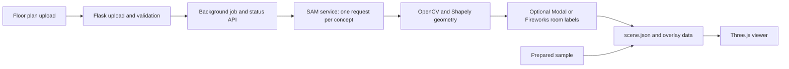

# FloorPlan3D

FloorPlan3D turns a 2D floor-plan image into a metric `scene.json` and a navigable Three.js view. The project has a prepared example for demos. Live segmentation requires a configured SAM service; the sample works without model API keys or inference calls. The page loads Three.js and Tailwind from CDNs, so the browser still needs network access to those assets.

## Current prototype

- **Offline demo:** loads the prepared sample plan, scene, segmentation overlay, room inspector, and 3D model without API keys.
- **Two-story demo:** loads the prepared plan as a stacked two-level building; use the story selector to inspect either floor or both together.
- **Multi-floor upload:** select up to eight plan images in ground-to-top order and process them as a building. Stories are aligned by the detected stair/elevator room when available, otherwise by a plan-center fallback; verify alignment before relying on cross-floor routes or measurements.
- **Live processing:** accepts PNG, JPG, and WebP images up to 10 MB, normalizes them to PNG, and runs SAM segmentation in a background job.
- **Geometry:** cleans masks, converts contours to meter coordinates, estimates scale from the median detected door width when enabled, and approximates walls from room outlines if no wall mask is returned.
- **Room labels:** uses the configured Modal classifier or Fireworks fallback. If neither returns usable labels, rooms stay generic and `scene.meta.warnings` explains the fallback.
- **Viewer:** renders floors, extruded walls, doors, windows, labels, shadows, cutaway height, room selection and focus, door-based shortest routes, scene JSON, and GLB export.

The viewer includes WASD first-person walkthrough with mouse look and approximate collision against detected wall polygons, 3D point-to-point measurement, two-point scale calibration, room/total area summaries, editable room labels/types and draggable room-outline vertices with undo, JSON/GLB export, and optional primitive furniture. The map assistant uses scene-grounded Muse Spark through Modal when configured, with a clearly identified deterministic offline lookup for common questions. Map checks report polygon completeness, connector counts, and any confidence values returned by the pipeline; they are not an accuracy score. Segmentation, geometry, connector alignment, and collision quality still depend on the uploaded drawing; review outputs before relying on them.

## Architecture



The SAM adapter calls only Baseten using `BASETEN_API_KEY` and either `BASETEN_SAM_URL` or `BASETEN_MODEL_ID`. The model ID builds Baseten's standard production prediction URL (`https://model-<id>.api.baseten.co/production/predict`). The request body sends a base64 data URL in `image` and the segmentation phrase in `prompt`; the deployed SAM endpoint must accept that payload and return masks in the supported `masks`, `predictions`, or `output` response shape. The app does not call `api.meta.ai` and does not run local model inference.

Room labeling sends the plan image and room candidates to Muse Spark through Modal's OpenAI-compatible chat completions endpoint. Set `MODAL_MUSE_SPARK_URL` and `MODAL_MUSE_SPARK_MODEL` to the endpoint URL and model name shown in the Modal dashboard. For Modal proxy authentication, `MODAL_API_KEY` accepts the combined `wk-<token-id>.ws-<token-secret>` token as a Bearer API key; Modal also documents separate `Modal-Key` and `Modal-Secret` headers. See the [Modal Proxy Tokens authentication guide](https://modal.com/docs/guide/webhook-proxy-auth) and [Endpoint integrations guide](https://modal.com/docs/guide/endpoint-integrations). If Modal is unavailable or returns incomplete labels, Fireworks Llama is used as a text/NLP classification fallback and that fallback is added to the scene warnings. Fireworks uses its OpenAI-compatible chat completions endpoint, `FIREWORKS_BASE_URL`, model ID, and `FIREWORKS_API_KEY`. When neither classifier is available, the scene uses generic labels and a warning.

> Configure only provider endpoints and model IDs you have verified for your account. The code’s Baseten adapter expects a response containing a `masks`, `predictions`, or `output` field; provider response formats can vary.

## Run the offline demo now

1. Install Python 3.12 or newer.
2. In PowerShell, create a project environment and install the dependencies. If your Python is installed somewhere else, replace the interpreter path with that Python 3.12+ executable:

   ```powershell
   & "$env:LOCALAPPDATA\Programs\Python\Python314\python.exe" -m venv .venv
   .\.venv\Scripts\python.exe -m pip install -r requirements.txt
   ```

3. Start the app with `run.bat`, or run `.\.venv\Scripts\python.exe app.py` in PowerShell.
4. Open `http://127.0.0.1:5000` and choose **Load Hackathon Demo Plan**.
5. Try room focus and routing, room selection, the 2D overlay and scene JSON tabs, cutaway view, and GLB export.
6. To process a real multi-floor building, select plan images together in ground-to-top order and choose **Process selected plans as stories**. Check each story against its source plan and verify stair/elevator alignment before showing cross-floor routes.
7. Select a room and choose **Edit room outline** to drag the cyan vertices in the 2D tab. Undo is available; finish editing, then export the corrected scene or GLB.
8. Ask the map assistant a question such as “Where is the Computer Lab?” It labels whether the response came from Muse Spark or offline lookup.

Use the same interpreter for installation and startup. On some Windows setups, `python` can point to a separate distribution that does not have the packages installed. Dependencies are pinned in `requirements.txt`; run tests with `python -m pytest -q`.

The page labels prepared scenes as **DEMO**, `MOCK_SAM=1` results as **MOCK MODE**, replayed provider payloads as **REPLAY MODE**, and only configured provider inference as **LIVE**. Mock processing always uses the bundled prepared plan and explicitly states that uploaded pixels were not analyzed. The mock path needs no provider keys. Placeholder values in `.env.example` are blank so they cannot accidentally enable live processing.

## Mock, record, and replay the SAM pipeline

Set `MOCK_SAM=1` in `.env` and restart the app to exercise the upload/job/geometry/UI path with realistic masks derived from the bundled sample. Mock results are clearly labeled and never represented as live results. The uploaded image is not used to produce the mock scene.

When Baseten credentials are configured, `RECORD_SAM_RESPONSES=1` stores each raw response in `recorded_sam_responses/`, keyed to the image and concept. That folder is gitignored. To reuse those payloads without contacting Baseten, set `REPLAY_SAM_RESPONSES=1` and `MOCK_SAM=0`; mock takes precedence if both are enabled. Replay requires the exact same normalized image and concept prompts to find a recording. Replay covers the four SAM calls; room labeling uses its deterministic offline fallback.

Four SAM concepts run concurrently with up to two retries for transient network/5xx failures and a total job budget controlled by `SAM_JOB_TIMEOUT_SECONDS` (default 180 seconds). The provider image is capped at 2048 pixels on its longest side and binary masks are resized back before geometry processing. Wall, door, and window failures add warnings; room segmentation failure stops the job. Upload concurrency is capped at two jobs and `/api/upload` allows ten requests per client IP per minute. Jobs and their results are held in memory and are lost when the server restarts.

## Configure live processing when your keys arrive

Copy `.env.example` to `.env`, then fill only the services you will use:

```ini
# Baseten SAM custom deployment
BASETEN_API_KEY=
# Set one of the following:
BASETEN_SAM_URL=
BASETEN_MODEL_ID=

# Modal Muse Spark Endpoint URL/model from the dashboard and proxy token
MODAL_API_KEY=
MODAL_MUSE_SPARK_URL=
MODAL_MUSE_SPARK_MODEL=

# Fireworks Llama 3 text/NLP (also used as classifier fallback)
FIREWORKS_API_KEY=
```

Keep `.env` private and never put keys in source files, screenshots, or commits. Restart Flask after editing `.env`. The page should then show **Live processing configured**. This confirms the Baseten key and endpoint settings are present; it does not confirm that the deployment is reachable or that its request/response schema matches the adapter. If no classifier is configured, processing still produces a scene with generic labels and a warning. Safe error categories are returned to the browser; provider response bodies and credentials remain in server logs only.

Live uploads use `POST /api/upload`, `GET /api/status/<job_id>`, and `GET /api/scene/<job_id>`. Uploads are limited to 10 MB and 20 megapixels. Supported formats are PNG, JPG, and WebP.

## Container run

Build and run with Docker, publishing port 8080. The image serves the app using Waitress. Keep .env out of the image; pass secrets through your deployment's environment configuration.

```sh
docker build -t floorplan3d .
docker run --rm -p 8080:8080 --env-file .env floorplan3d
```

## Scale and geometry notes

Automatic scale estimation is enabled by default and assumes the median detected door width is 0.9 m. If doors cannot be detected reliably, the selected scale is used and the scene includes a warning. Uncheck the option to use the meters-per-pixel slider directly. In either mode, verify dimensions against a known measurement before relying on them.

Coordinates in `scene.json` are meters, with the source plan’s top-left as origin, x increasing right, and y increasing down. The viewer centers the geometry for display; exported JSON keeps the plan coordinates. Multi-story examples declare `meta.levels` and `meta.floorHeight`; each room, wall, door, and window can carry a zero-based `level`.

## Demo rehearsal

See [DEMO.md](DEMO.md) for a two-minute flow and recovery steps. Use the built-in sample or mock pipeline if keys or providers are unavailable. Describe demo/mock/replay results using their visible labels; live-upload results are model-assisted estimates.

## Project files

```text
app.py                    Flask UI, validation, background jobs, scene API
sam_service.py            SAM calls and room-classification adapter
cloud_services.py         Baseten, Modal, and Fireworks integrations
geometry_processor.py     Mask cleanup, polygon conversion, scale, doors, walls
demo_data.py              Prepared sample plan, scene, and overlays
templates/index.html      Single-page interface
static/js/app.js          Upload, progress, tabs, inspector, downloads
static/js/viewer.js       Three.js renderer and GLB export
```
