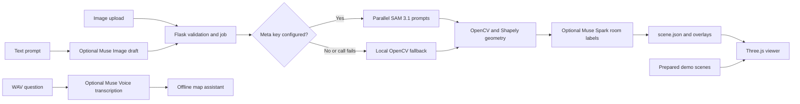

# FloorPlan3D

FloorPlan3D converts 2D floor-plan images into metric scene data and a navigable Three.js model. Prepared one-story and two-story demos run offline and need no API key.

## Architecture



With `META_API_KEY` configured, the app sends four parallel image prompts to Meta SAM 3.1 and decodes its pixel masks into scene geometry. If SAM is not configured or a concept request fails, the corresponding concept falls back to local OpenCV heuristics. Muse Spark optionally suggests room labels through the same Meta key. Without a key, uploads still work locally with generic labels. Prepared demos never call either model. The map assistant remains a deterministic local scene lookup.

## Run on Windows

```powershell
py -3.12 -m venv .venv
.\.venv\Scripts\python.exe -m pip install -r requirements.txt
Copy-Item .env.example .env
.\.venv\Scripts\python.exe app.py
```

Open http://127.0.0.1:5000. If the Python launcher is unavailable, use your installed Python executable to create the environment. Use the same environment for install and run.

## Run on macOS or Linux

```sh
python3 -m venv .venv
.venv/bin/python -m pip install -r requirements.txt
cp .env.example .env
.venv/bin/python app.py
```

## What works without a key

Both prepared demos, upload processing, local heuristic segmentation, generic room labels, and offline map questions. Four local segmentation jobs process rooms, walls, doors, and windows in parallel. Door and window masks may be omitted when heuristics cannot identify them reliably; wall geometry can fall back to room outlines. Failure to detect rooms is reported clearly.

## Optional Meta models

All hosted models use one Meta Model API key. SAM 3.1 segments uploads; Muse Spark suggests room labels; Muse Image can generate a draft floor-plan image from a text description; Muse Voice Transcribe converts a WAV question to text for the map assistant. The generated plan is a visual draft and its dimensions/walls are not guaranteed. Voice transcription currently accepts mono, 16-bit PCM WAV at 16 or 24 kHz, up to 10 minutes. The model IDs are configurable in `.env` and default to `sam-3.1`, `muse-spark-1.3`, `muse-image-1.0`, and `muse-voice-transcribe-1.0`, with base URL `https://api.meta.ai/v1`. When your account has access:

1. Open .env in the project folder.
2. Set `META_API_KEY` to your key from the Meta Model API dashboard.
3. Keep the base URL and model IDs from `.env.example` unless Meta provides different values for your account.
4. Restart Flask. The page badge and `/api/health` show whether SAM and Muse are configured.

SAM uses the Responses API and Meta's official `meta-sam-parser` package. Muse Spark uses Chat Completions for room labels. Muse Image uses image generation. Voice Transcribe uses Meta's multipart transcription endpoint. See [SAM segmentation](https://dev.meta.ai/docs/sam/overview), [Muse image generation](https://dev.meta.ai/docs/cookbook/image-generation-basics), and [Muse speech-to-text](https://dev.meta.ai/docs/speech-to-text). Configured settings do not prove your account can access the models; test with your key when available. SAM failures fall back per concept to OpenCV; Muse Spark failures use generic room labels. Credentials and raw provider responses are not returned to the browser.

## Limitations

Heuristic segmentation works best on clean, high-contrast plans with closed room boundaries. Text, furniture, shadows, low contrast and door gaps can affect results. Door and window detections may be empty or incomplete. Scale and area are estimates and should be checked against known dimensions. This prototype is for visualization only, not construction, compliance, evacuation or safety decisions.

## Tests

Run `python -m pytest -q`. Tests use local fixtures and mocked API clients; they do not make real network calls. Live SAM and Muse access remain unverified until tested with an account key.

To check local segmentation and geometry against the bundled sample plan without an API key, run `python scripts/evaluate_local_segmentation.py`. It reports mask and final geometry counts and applies loose fixture guardrails for room, wall, door, and window detection. This is a regression check for that one sample, not an accuracy score or a guarantee for other floor plans.

## Demo review flow

Use the sidebar's **Quick judge walkthrough** to rehearse the key features. The **Area Summary** review checklist reports structural details such as usable room outlines, detected wall/opening regions, scale calibration status, floor connectors, labels, and pipeline warnings. **Review 2D detections** opens the overlay; **Edit a room outline** selects a room and starts the boundary editor. Review all detected geometry and verify scale against a known dimension before relying on measurements.
