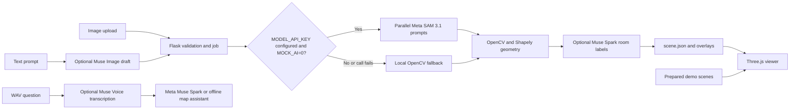

# FloorPlan3D

FloorPlan3D converts 2D floor-plan images into metric scene data and a navigable Three.js model. Prepared one-story and two-story demos run offline and need no API key.

## Architecture



With `MODEL_API_KEY` configured and `MOCK_AI=0`, the app sends parallel concept prompts to Meta SAM 3.1; failed concepts fall back gracefully to local OpenCV heuristics. Meta Muse Spark suggests room labels and answers scene-grounded map questions. Without an API key or with `MOCK_AI=1`, uploads and deterministic map lookups run locally. Prepared demos never call external providers.

---

## First 10 Minutes with a Real Key

1. **Copy configuration template**:
   ```powershell
   Copy-Item .env.example .env
   ```
2. **Configure your key**:
   Open `.env` and set:
   ```env
   MODEL_API_KEY=your_meta_model_api_key_here
   MODEL_BASE_URL=https://api.meta.ai/v1
   SAM_MODEL=sam-3.1
   MUSE_MODEL=muse-spark-1.3
   MOCK_AI=0
   ```
3. **Verify API key and connectivity**:
   ```powershell
   py scripts/check_keys.py
   ```
   Or to view all models available to your account:
   ```powershell
   py scripts/check_keys.py --list-models
   ```
4. **Start the application**:
   ```powershell
   py app.py
   ```
5. **Open studio**:
   Navigate to `http://127.0.0.1:5000`.
6. **Upload and test a plan**:
   Upload a PNG, JPG, or WebP plan (up to 10 MB). Click **Generate 3D Model**.
7. **Understand status chips**:
   - `MOCK MODE - PREPARED SAMPLE`: `MOCK_AI=1` is active. Image pixels were not sent to AI models; prepared sample geometry is used.
   - `LIVE (SAM 3.1 + Muse Spark)`: Live Meta Model API successfully segmented the floor plan.
   - `LOCAL OPENCV SEGMENTATION`: Key is not configured or an API error occurred; local OpenCV heuristics were used as a fallback.

---

## Privacy and Model Tier Policy

FloorPlan3D is designed for enterprise privacy. Architectural floor plans can represent confidential corporate layouts, secure facilities, or private residences.

- **Standard-tier requirement**: FloorPlan3D strictly requires Standard-tier model identifiers (such as `muse-spark-1.3`).
- **Contributor model rejection**: Any model ID containing `contributor` (e.g. `meta-models/muse-spark-open-1026-contributor`) is strictly rejected at application startup with an explicit `ValueError`. Standard-tier guarantees that customer blueprints and inputs are not used for foundation model training.
- **Credential security**: API keys are never written to logs, never sent to the browser client, never included in `scene.json`, and never returned in error responses.

---

## Troubleshooting Guide

| Issue / Code | Cause | Recommended Solution |
| :--- | :--- | :--- |
| **401 Unauthorized** | Invalid or expired `MODEL_API_KEY`. | Check `.env` for typos or leading/trailing whitespace. Re-generate key on Meta dashboard. |
| **403 Forbidden** | Account lack permission for model. | Verify model access (`sam-3.1`, `muse-spark-1.3`) and ensure model terms of use are accepted. |
| **404 Not Found** | Incorrect endpoint or model ID. | Ensure `MODEL_BASE_URL=https://api.meta.ai/v1` and model name is exactly `sam-3.1`. |
| **429 Rate Limit** | Provider concurrency or quota exceeded. | App automatically retries with exponential backoff (up to 3 times) before falling back to local OpenCV. |
| **Timeout (75s)** | Network latency or excessive image resolution. | Large plans are automatically downsampled to `MAX_IMAGE_SIDE=1500`. If SAM times out, OpenCV fallback activates. |
| **No matches found** | Low contrast or cluttered blueprint. | Ensure drawing lines are dark on a light background. Use the 2D editor to trace or adjust room polygons. |
| **Bad masks** | Complex multi-line or hand-drawn walls. | Use the 2D vertex editor to adjust boundary points, or toggle manual scale calibration. |

---

## Demo Day Checklist

Before presenting FloorPlan3D to evaluators or judges:

- [ ] **Pre-warm on-disk cache**: Run the 3 sample plans once in live mode so masks are stored in `cache/sam/`. Cached plans load with 0s API delay.
- [ ] **MOCK_AI fallback ready**: Verify that switching `.env` to `MOCK_AI=1` immediately allows offline presentation without internet dependency.
- [ ] **Verify smoke tests pass**: Run `py scripts/smoke.py` and confirm all 7 test stages pass.
- [ ] **Check git tag**: Ensure codebase is clean and tagged at commit `ready-for-keys`.

---

## Run on Windows

```powershell
py -3.14 -m venv .venv
.\.venv\Scripts\python.exe -m pip install -r requirements.txt
Copy-Item .env.example .env
.\.venv\Scripts\python.exe app.py
```

Open http://127.0.0.1:5000.

## Run on macOS or Linux

```sh
python3 -m venv .venv
.venv/bin/python -m pip install -r requirements.txt
cp .env.example .env
.venv/bin/python app.py
```

---

## Limitations

Heuristic segmentation works best on clean, high-contrast plans with closed room boundaries. Text, furniture, shadows, low contrast and door gaps can affect results. Door and window detections may be empty or incomplete. Scale and area are estimates and should be checked against known dimensions. This prototype is for visualization only, not construction, compliance, evacuation or safety decisions.

## Tests

Run `py -m pytest -q`. Tests use local fixtures and mocked API clients; they do not make real network calls.

Run end-to-end smoke verification:
```powershell
py scripts/smoke.py
```

Run emoji audit:
```powershell
py scripts/check_no_emoji.py
```
