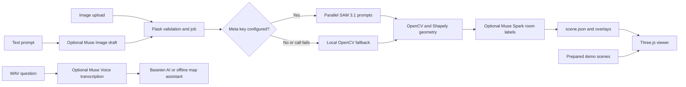

# FloorPlan3D

FloorPlan3D converts 2D floor-plan images into metric scene data and a navigable Three.js model. Prepared one-story and two-story demos run offline and need no API key.

## Architecture



With `META_API_KEY` configured, the app can send four parallel image prompts to Meta SAM 3.1; failed concepts fall back to local OpenCV. A Baseten key enables Muse Spark Open for room labels and scene-grounded map questions. Without either key, uploads and the deterministic map lookup still work locally. Prepared demos never call providers.

## Run on Windows

```powershell
py -3.12 -m venv .venv
.\.venv\Scripts\python.exe -m pip install -r requirements.txt
Copy-Item .env.example .env
.\.venv\Scripts\python.exe app.py
```

Open http://127.0.0.1:5000. If the Python launcher is unavailable, use your installed Python executable to create the environment. Use the same environment for install and run.

## Run on macOS or Linux

```sh
python3 -m venv .venv
.venv/bin/python -m pip install -r requirements.txt
cp .env.example .env
.venv/bin/python app.py
```

## What works without a key

Both prepared demos, upload processing, local heuristic segmentation, generic room labels, and offline map questions. Four local segmentation jobs process rooms, walls, doors, and windows in parallel. Door and window masks may be omitted when heuristics cannot identify them reliably; wall geometry can fall back to room outlines. Failure to detect rooms is reported clearly.

## Optional Meta models

Baseten provides the `meta-models/muse-spark-open-1026` model through `https://inference.baseten.co/v1`. Its `BASETEN_API_KEY` enables room labeling and an AI map assistant grounded in the loaded scene. Set these values in `.env`:

```env
BASETEN_API_KEY=your_key_here
BASETEN_API_BASE_URL=https://inference.baseten.co/v1
BASETEN_MUSE_MODEL=meta-models/muse-spark-open-1026
```

Baseten token counts are recorded for successful provider responses in the local, gitignored `local_data/baseten_usage.json` file. The current totals are also available from the local `/api/usage` endpoint. This tracking starts after the updated app is restarted and cannot recover usage from earlier requests; it is not a balance or cost estimate.

SAM 3.1, Muse Image, and Muse Voice are separate Meta Model API services and still require `META_API_KEY`; the Baseten key does not authenticate those endpoints. Without that Meta key the project uses OpenCV segmentation, and the image/voice features remain unavailable. Muse Image outputs are visual drafts, not verified architectural plans. Voice transcription accepts mono, 16-bit PCM WAV at 16 or 24 kHz, up to 10 minutes. To enable optional Meta-hosted features, add a separate `META_API_KEY` and keep the model IDs from `.env.example`:

1. Open .env in the project folder.
2. Set `META_API_KEY` only if you have Meta Model API access for SAM, Muse Image, or Muse Voice.
3. Set the exact model IDs provided by your Meta dashboard.
4. Restart Flask. The page badge and `/api/health` show whether SAM and Muse are configured.

SAM uses Meta's Responses API and official parser. Muse Spark Open uses the OpenAI-compatible Baseten endpoint. Muse Image and Voice Transcribe are optional Meta services. See [Baseten's inference quickstart](https://docs.baseten.co/inference/overview), [Meta SAM docs](https://dev.meta.ai/docs/sam/overview), [Muse image generation](https://dev.meta.ai/docs/cookbook/image-generation-basics), and [Muse speech-to-text](https://dev.meta.ai/docs/speech-to-text). Account access is unverified until tested with your credentials. Provider failures fall back safely where available; credentials and raw provider responses are not returned to the browser.

## Limitations

Heuristic segmentation works best on clean, high-contrast plans with closed room boundaries. Text, furniture, shadows, low contrast and door gaps can affect results. Door and window detections may be empty or incomplete. Scale and area are estimates and should be checked against known dimensions. This prototype is for visualization only, not construction, compliance, evacuation or safety decisions.

## Tests

Run `python -m pytest -q`. Tests use local fixtures and mocked API clients; they do not make real network calls. Live SAM and Muse access remain unverified until tested with an account key.

To check local segmentation and geometry against the bundled sample plan without an API key, run `python scripts/evaluate_local_segmentation.py`. It reports mask and final geometry counts and applies loose fixture guardrails for room, wall, door, and window detection. This is a regression check for that one sample, not an accuracy score or a guarantee for other floor plans.

## Demo review flow

Use the sidebar's **Quick judge walkthrough** to rehearse the key features. The **Area Summary** includes an AI plan review and a one-click building summary; both use the current scene facts and still work offline with deterministic text. The map assistant can answer scene questions and resolve explicit requests such as “route from East Lobby to Computer Lab” into the existing door/stairs route planner. The **Review 2D detections** button opens the overlay; **Edit a room outline** selects a room and starts the boundary editor. Review all detected geometry and verify scale against a known dimension before relying on measurements. AI text is grounded in detected scene data but is not a building-code, construction, or safety assessment.

The 3D view also includes a time-of-day lighting preview, a 2D blueprint underlay for visual alignment checks, an exterior walkthrough view, and an egress connectivity preview through detected doors and stairs. These are visualization aids: exit candidates and travel lengths can be inferred from imperfect geometry and must not be used for evacuation planning or to claim code compliance.
